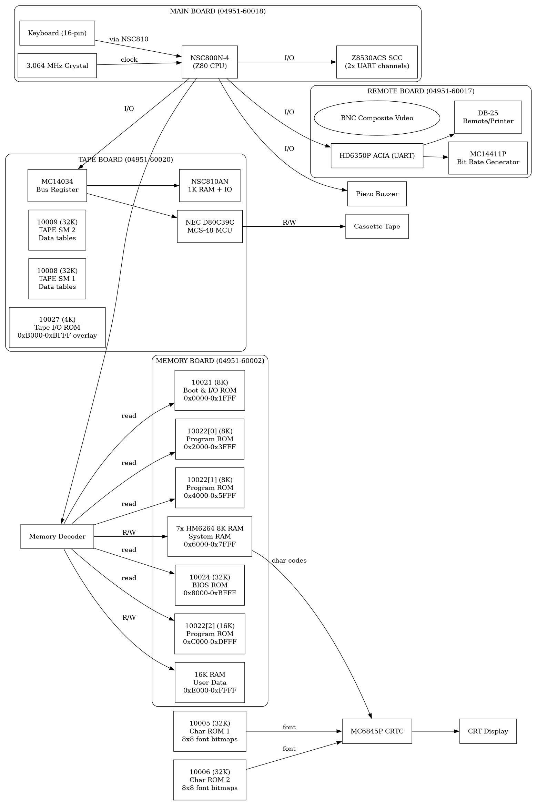

# HP 4951B System Block Diagram



## Z80 Memory Map (64K)

| Address | Size | Type | EPROM | Description |
|---|---|---|---|---|
| 0x0000-0x1FFF | 8K | ROM | 04951-10021 | Boot & I/O ROM. Entry: JP 0x0850. RST 0x38 at 0x0038. I/O init. |
| 0x2000-0x3FFF | 8K | ROM | 04951-10022 [0] | Main Program ROM (part 1) |
| 0x4000-0x5FFF | 8K | ROM | 04951-10022 [1] | Main Program ROM (part 2) |
| 0x6000-0x7FFF | 16K | RAM | 7x HM6264LP-15 | Display buffer (0x6000+) + system vars (0x7000+) + stack |
| 0x8000-0xBFFF | 32K | ROM | 04951-10024 | BIOS ROM (Rev 2506). Vectors: 0x8000-0x808C. Code: 0x808D+ |
| 0xB000-0xBFFF | 4K | ROM | 04951-10027 | Tape/Disk I/O (overlay on BIOS, selected when TAPE active) |
| 0xC000-0xDFFF | 16K | ROM | 04951-10022 [2] | Main Program ROM (part 3) |
| 0xE000-0xFFFF | 16K | RAM | - | User data / program storage |

**Char ROMs** (10005, 10006): Not in Z80 address space. Connected to MC6845P CRTC as character generator. Z80 writes char codes to RAM 0x6000+; CRTC reads 8x8 font bitmaps from char ROMs.

## Boards

| Board | Part # | Key ICs |
|---|---|---|
| MAIN | 04951-60018 | NSC800N (Z80), MC6845P CRTC, Z8530 SCC, 2x Char ROM, 2x HM6116 2K RAM, HM6264 8K RAM, TDA4700A SMPS |
| MEMORY | 04951-60002 | 4x EPROM (10021/22/23/24), 7x HM6264 8K RAM, NSC810AN, keyboard, battery, buzzer |
| TAPE | 04951-60020 | NEC D80C39C MCU, NSC810AN, 3x EPROM, MC14034 |
| REMOTE | 04951-60017 | HD6350P ACIA, MC14411P BRG |

## Data Flow

```
Keyboard --> MEMORY board --> Z80 (NSC800N)
                                    |
                                    +--> RAM (display buffer) --> CRTC --> CRT
                                    |
                                    +--> Z8530 SCC --> RS-232 / BNC video
                                    |
                                    +--> TAPE board (via MC14034 bus reg)
                                         |
                                         +--> D80C39C MCU --> Cassette Tape
```
